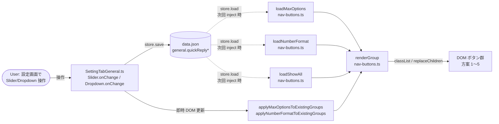

# 方案ボタン最大数・番号フォーマット切替 設計書

> 📅 作成日: 2026-09-19
> 🏷️ F-058 / v0.56.0
> 📂 ソース: `src/features/quick-reply/nav-buttons.ts` / `src/settings/SettingTabGeneral.ts` / `src/core/settings.ts` / `src/core/i18n.ts`

---

## 概要

v0.24.0（F-021）で導入した「方案ボタンを常に表示（`general.quickReplyShowAllOptions`）」の拡張として、以下 2 つの新規設定を追加する：

1. **`general.quickReplyMaxOptions`** (number, 1〜5): showAll ON 時の方案ボタン最大表示数
2. **`general.quickReplyNumberFormat`** ('arabic' | 'circled' | 'emoji' | 'text'): 方案ボタンの番号フォーマット

ご主人様の「設定画面にて最大数とデザインを選択切り替えできるようにしたい」要望に対応する。

---

## セクション 1: 設定スキーマ

### 新規型・定数（`src/core/settings.ts`）

```typescript
/** v0.56.0 (F-058): 方案ボタンの番号フォーマット */
export type QuickReplyNumberFormat = 'arabic' | 'circled' | 'emoji' | 'text';

export const QUICK_REPLY_NUMBER_FORMATS: readonly QuickReplyNumberFormat[] =
  ['arabic', 'circled', 'emoji', 'text'] as const;

export const QUICK_REPLY_MAX_OPTIONS_MIN = 1;
export const QUICK_REPLY_MAX_OPTIONS_MAX = 5;
export const QUICK_REPLY_MAX_OPTIONS_DEFAULT = 5;
```

### `ClaudianBridgeSettings.general` への追加

```typescript
// v0.56.0 (F-058): 方案ボタンの最大表示数（1〜5・既定 5）
quickReplyMaxOptions: number;
// v0.56.0 (F-058): 方案ボタンの番号フォーマット（既定 'arabic'）
quickReplyNumberFormat: QuickReplyNumberFormat;
```

### `DEFAULT_CLAUDIAN_BRIDGE_SETTINGS.general` への追加

```typescript
quickReplyMaxOptions: QUICK_REPLY_MAX_OPTIONS_DEFAULT,
quickReplyNumberFormat: 'arabic' as QuickReplyNumberFormat,
```

### `normalizeClaudianBridgeSettings` での補完

```typescript
// 数値は [1, 5] にクランプ
quickReplyMaxOptions: clampNum(
  r.general?.quickReplyMaxOptions,
  QUICK_REPLY_MAX_OPTIONS_MIN,
  QUICK_REPLY_MAX_OPTIONS_MAX,
  QUICK_REPLY_MAX_OPTIONS_DEFAULT,
),
// enum はホワイトリスト、不正値は 'arabic' にフォールバック
quickReplyNumberFormat: QUICK_REPLY_NUMBER_FORMATS.includes(
  r.general?.quickReplyNumberFormat as QuickReplyNumberFormat,
)
  ? (r.general?.quickReplyNumberFormat as QuickReplyNumberFormat)
  : 'arabic',
```

### `validateClaudianBridgeSettings` での検証

```typescript
if (
  !Number.isInteger(cfg.general.quickReplyMaxOptions) ||
  cfg.general.quickReplyMaxOptions < QUICK_REPLY_MAX_OPTIONS_MIN ||
  cfg.general.quickReplyMaxOptions > QUICK_REPLY_MAX_OPTIONS_MAX
) {
  return `general.quickReplyMaxOptions は ${QUICK_REPLY_MAX_OPTIONS_MIN}〜${QUICK_REPLY_MAX_OPTIONS_MAX} の整数である必要があります`;
}
if (!QUICK_REPLY_NUMBER_FORMATS.includes(cfg.general.quickReplyNumberFormat)) {
  return `general.quickReplyNumberFormat は ${QUICK_REPLY_NUMBER_FORMATS.join(' / ')} のいずれかである必要があります`;
}
```

---

## セクション 2: ボタン描画ロジック（`src/features/quick-reply/nav-buttons.ts`）

### `renderGroup()` の新シグネチャ

```typescript
function renderGroup(
  group: Element,
  state: RecommendState,
  showAllOptions: boolean,
  maxOptions: number,            // 新規追加
  numberFormat: QuickReplyNumberFormat,  // 新規追加
): void {
  // optionCount は最大値を maxOptions にクランプ
  const optionCount = showAllOptions
    ? maxOptions
    : Math.min(state.maxOptionCount, maxOptions);
  for (let i = 1; i <= MAX_OPTIONS; i++) {
    const btn = group.querySelector(`[data-cb-qr-${i}]`);
    if (!btn) continue;
    btn.classList.toggle('cb-hidden', i > optionCount);
    btn.classList.toggle('is-recommended', state.recommended === i);
    // visible な 1〜optionCount のみフォーマット更新
    if (i <= optionCount) {
      applyNumberFormat(btn, i, numberFormat);
    }
  }
}

function applyNumberFormat(btn: Element, n: number, format: QuickReplyNumberFormat): void {
  if (format === 'text') {
    // 方案N テキスト: SVG バッジを撤去してプレーンな文字に
    btn.replaceChildren(document.createTextNode(`方案${n}`));
  } else {
    // SVG 円バッジ維持（中の数字だけ差し替え）
    btn.replaceChildren(createNumberedBadge(n, format));
  }
}
```

### `createNumberedBadge(n, format)` の修正

```typescript
function createNumberedBadge(n: number, format: QuickReplyNumberFormat): SVGElement {
  // ...既存の SVG 構造（circle + text）は変更なし
  // text.textContent を format に応じて切替
  text.textContent = formatText(n, format);
}

function formatText(n: number, format: QuickReplyNumberFormat): string {
  switch (format) {
    case 'circled':
      return ['', '①', '②', '③', '④', '⑤'][n] ?? String(n);
    case 'emoji':
      return ['', '1️⃣', '2️⃣', '3️⃣', '4️⃣', '5️⃣'][n] ?? String(n);
    case 'text':
    case 'arabic':
    default:
      return String(n);
  }
}
```

### 設定ロードヘルパー追加

```typescript
const loadMaxOptions = (): number => {
  try {
    const cfg = store.load() as ClaudianBridgeSettings | null;
    const v = cfg?.general?.quickReplyMaxOptions;
    if (typeof v === 'number' && Number.isInteger(v)) {
      return Math.max(QUICK_REPLY_MAX_OPTIONS_MIN, Math.min(QUICK_REPLY_MAX_OPTIONS_MAX, v));
    }
    return QUICK_REPLY_MAX_OPTIONS_DEFAULT;
  } catch {
    return QUICK_REPLY_MAX_OPTIONS_DEFAULT;
  }
};

const loadNumberFormat = (): QuickReplyNumberFormat => {
  try {
    const cfg = store.load() as ClaudianBridgeSettings | null;
    const f = cfg?.general?.quickReplyNumberFormat;
    return QUICK_REPLY_NUMBER_FORMATS.includes(f as QuickReplyNumberFormat)
      ? (f as QuickReplyNumberFormat)
      : 'arabic';
  } catch {
    return 'arabic';
  }
};
```

### `inject()` 末尾の更新（v0.55.1 で追加した即時 renderGroup）

```typescript
// F-021 + F-058 統合
renderGroup(
  group,
  { recommended: null, maxOptionCount: 0 },
  loadShowAll(),
  loadMaxOptions(),
  loadNumberFormat(),
);
```

### `setupRecommendDetection` の callback 更新

```typescript
const offDetect = setupRecommendDetection(app, (state) => {
  const showAll = loadShowAll();
  const max = loadMaxOptions();
  const fmt = loadNumberFormat();
  if (!loadEnabled()) return;
  document.querySelectorAll(`[${GROUP_MARK}]`).forEach((group) =>
    renderGroup(group, state, showAll, max, fmt),
  );
});
```

### 既存 group への即時反映ヘルパー（export）

```typescript
export function applyMaxOptionsToExistingGroups(
  maxOptions: number,
  showAllOptions: boolean,
  numberFormat: QuickReplyNumberFormat,
): void {
  document.querySelectorAll(`[${GROUP_MARK}]`).forEach((group) => {
    renderGroup(group, { recommended: null, maxOptionCount: 0 }, showAllOptions, maxOptions, numberFormat);
  });
}

export function applyNumberFormatToExistingGroups(
  maxOptions: number,
  showAllOptions: boolean,
  numberFormat: QuickReplyNumberFormat,
): void {
  // applyMaxOptionsToExistingGroups と同じ実装（renderGroup が両方を更新するため）
  applyMaxOptionsToExistingGroups(maxOptions, showAllOptions, numberFormat);
}
```

---

## セクション 3: 設定 UI（`src/settings/SettingTabGeneral.ts`）+ i18n

### UI 配置

```
| ✅ 方案ボタンを常に表示  [Toggle ON/OFF] |
|   方案を最大で表示  [Slider 1─5]              ← F-058 新規
|   方案ボタン番号フォーマット  [Dropdown]       ← F-058 新規
|   クイック返信ボタンを表示  [Toggle ON/OFF] |
```

### 実装（既存 `quickReplyShowAllOptions` の直下に挿入）

```typescript
// === v0.56.0 (F-058): 方案ボタンの最大表示数 ===
new Setting(containerEl)
  .setName(s.quickReplyMaxOptions)
  .setDesc(s.quickReplyMaxOptionsDesc)
  .addSlider((slider) =>
    slider
      .setLimits(QUICK_REPLY_MAX_OPTIONS_MIN, QUICK_REPLY_MAX_OPTIONS_MAX, 1)
      .setValue(cfg.general.quickReplyMaxOptions)
      .setDynamicTooltip()
      .onChange(async (v) => {
        try {
          const latest = store.load();
          store.save({ ...latest, general: { ...latest.general, quickReplyMaxOptions: v } });
          new Notice(s.noticeSaved);
          applyMaxOptionsToExistingGroups(v, loadShowAll(), loadNumberFormat());
        } catch (e) {
          new Notice(s.noticeSaveFailed.replace('{msg}', (e as Error).message));
          draw();
        }
      }));

// === v0.56.0 (F-058): 方案ボタンの番号フォーマット ===
new Setting(containerEl)
  .setName(s.quickReplyNumberFormat)
  .setDesc(s.quickReplyNumberFormatDesc)
  .addDropdown((dropdown) =>
    dropdown
      .addOption('arabic', s.quickReplyNumberFormatArabic)
      .addOption('circled', s.quickReplyNumberFormatCircled)
      .addOption('emoji', s.quickReplyNumberFormatEmoji)
      .addOption('text', s.quickReplyNumberFormatText)
      .setValue(cfg.general.quickReplyNumberFormat)
      .onChange(async (v) => {
        try {
          const latest = store.load();
          store.save({ ...latest, general: { ...latest.general, quickReplyNumberFormat: v as QuickReplyNumberFormat } });
          new Notice(s.noticeSaved);
          applyNumberFormatToExistingGroups(loadMaxOptions(), loadShowAll(), v as QuickReplyNumberFormat);
        } catch (e) {
          new Notice(s.noticeSaveFailed.replace('{msg}', (e as Error).message));
          draw();
        }
      }));
```

### i18n 追加キー（`src/core/i18n.ts`）

| キー名 | ja | en | zh |
|:--|:--|:--|:--|
| `quickReplyMaxOptions` | 方案を最大 N 個表示 | Show up to N options | 最多显示 N 个方案 |
| `quickReplyMaxOptionsDesc` | showAll ON 時の方案ボタン数を 1〜5 で制限 | Limit option buttons to 1–5 when always-shown is ON | 显示开启时方案按钮数 1–5 |
| `quickReplyNumberFormat` | 方案ボタン番号フォーマット | Option button number format | 方案按钮编号格式 |
| `quickReplyNumberFormatDesc` | 方案 1〜5 の表示方法を選択（数字／丸数字／絵文字／テキスト） | Choose how options 1–5 are displayed (Arabic/Circled/Emoji/Text) | 选择方案 1–5 的显示方式 |
| `quickReplyNumberFormatArabic` | 数字 (1, 2, 3) | Arabic (1, 2, 3) | 阿拉伯数字 (1, 2, 3) |
| `quickReplyNumberFormatCircled` | 丸付き数字 (①, ②, ③) | Circled (①, ②, ③) | 带圈数字 (①, ②, ③) |
| `quickReplyNumberFormatEmoji` | 絵文字 (1️⃣, 2️⃣, 3️⃣) | Emoji (1️⃣, 2️⃣, 3️⃣) | 表情符号 (1️⃣, 2️⃣, 3️⃣) |
| `quickReplyNumberFormatText` | テキスト (方案1, 方案2) | Text (方案1, 方案2) | 文本 (方案1, 方案2) |

---

## セクション 4: テスト設計・F 番号・スコープ

### 新規 F 番号

> 📌 **F-058** = 「方案ボタン最大数・デザイン選択切替」(`general.quickReplyMaxOptions` + `general.quickReplyNumberFormat`)

v0.24.0 の F-021 は「方案ボタンを常に表示」の bool トグルとして残し、F-058 は**追加機能（数値・enum 拡張）**として独立。

### テスト追加

**`tests/features/quick-reply/nav-buttons.test.ts`** （11 ケース追加）:

| シナリオ | 検証内容 |
|:--|:--|
| maxOptions=3 + showAll=true | 注入直後に方案 1〜3 が表示、4〜5 は `cb-hidden` |
| maxOptions=1 + showAll=true | 方案 1 のみ表示、2〜5 は hidden |
| maxOptions=5 + showAll=false + state.maxOptionCount=3 | 既存挙動通り 1〜3 表示 |
| maxOptions=3 + showAll=false + state.maxOptionCount=5 | 1〜3 表示（maxOptions でクランプ）|
| format='arabic' | SVG badge textContent='1' |
| format='circled' | SVG badge textContent='①' |
| format='emoji' | SVG badge textContent='1️⃣' |
| format='text' | SVG 撤去・textContent='方案1' |
| 不正な maxOptions（0, 6, NaN, '3'）| clamp で 1〜5 に補正 |
| 不正な numberFormat（'binary', undefined, null）| 'arabic' にフォールバック |
| 既存 F-021 テスト 16 ケース | 全て pass（後方互換）|

**`src/core/settings.test.ts`** （4 ケース追加）:

| シナリオ | 検証内容 |
|:--|:--|
| normalize で quickReplyMaxOptions 欠落 | 既定値 5 |
| normalize で quickReplyNumberFormat 欠落 | 既定値 'arabic' |
| normalize で maxOptions=10 | 5 にクランプ |
| normalize で numberFormat='unknown' | 'arabic' にフォールバック |

**`tests/settings/ClaudianBridgeSettingTab.test.ts`** （5 ケース追加）:

| シナリオ | 検証内容 |
|:--|:--|
| Slider + Dropdown が描画される | DOM 検証 |
| Slider のデフォルト値が 5 | 初期表示 |
| Dropdown のデフォルト選択が 'arabic' | 初期表示 |
| Slider 変更 → store.save + DOM 反映 | onChange |
| Dropdown 変更 → store.save + DOM 反映 | onChange |

### スコープ

| 含める | 含めない（YAGNI） |
|:--|:--|
| quickReplyMaxOptions (1〜5) | OK/NG ボタンのデザイン変更 |
| quickReplyNumberFormat (4 種) | ボタン形状（円/角/四角）|
| 一般タブ内 2 コントロール追加 | 新規サブタブ化 |
| i18n 4 言語対応 | ライブプレビュー |
| 既存挙動の回帰テスト | 設定 export/import 機能 |

### 影響を受けるファイル

| ファイル | 変更内容 | 行数（概算） |
|:--|:--|--:|
| `src/core/settings.ts` | 型・定数・normalize・validate | +30 行 |
| `src/features/quick-reply/nav-buttons.ts` | renderGroup・createNumberedBadge・apply ヘルパー・loadMax/loadFormat | +40 行 |
| `src/settings/SettingTabGeneral.ts` | Slider + Dropdown + onChange | +30 行 |
| `src/core/i18n.ts` | 8 キー × 4 言語 = 32 文字列 | +40 行 |
| `tests/features/quick-reply/nav-buttons.test.ts` | 11 ケース追加 | +180 行 |
| `src/core/settings.test.ts` | normalize 4 ケース追加 | +50 行 |
| `tests/settings/ClaudianBridgeSettingTab.test.ts` | 5 ケース追加 | +80 行 |
| `CHANGELOG.md` | v0.56.0 エントリ | +30 行 |
| `package.json` / `Plugin/manifest.json` / `src/manifest.json` | version 0.56.0 | 3 行 |

---

## セクション 5: エラーハンドリング・境界条件

### データ取得失敗

| シナリオ | 挙動 |
|:--|:--|
| `store.load()` が例外を throw | `loadMaxOptions` / `loadNumberFormat` とも try/catch で吸収し既定値を返す |
| `store.load()` の戻り値が null | optional chaining で undefined → 既定値フォールバック |
| data.json が破損 | normalize 後の型で扱うため、起動時に既定値にリセット（過剰プロパティ許容）|

### 設定値の境界

| 入力 | 期待動作 | 実装 |
|:--|:--|:--|
| `quickReplyMaxOptions = 0` | 5 にフォールバック（clamp）| `Math.max(MIN, ...)` |
| `quickReplyMaxOptions = -1` | 1 にクランプ | `Math.max(MIN, ...)` |
| `quickReplyMaxOptions = 6` | 5 にクランプ | `Math.min(MAX, ...)` |
| `quickReplyMaxOptions = 3.7` | 4 にクランプ（round）| `Math.round(v)` |
| `quickReplyMaxOptions = NaN` | 5 にフォールバック | `Number.isInteger` ガード |
| `quickReplyMaxOptions = "3"` | 5 にフォールバック | `typeof v === 'number'` ガード |
| `quickReplyMaxOptions = undefined` | 5 にフォールバック | optional chain + typeof |
| `quickReplyNumberFormat = 'binary'` | 'arabic' にフォールバック | `QUICK_REPLY_NUMBER_FORMATS.includes` |
| `quickReplyNumberFormat = null` | 'arabic' にフォールバック | includes ガード |
| `quickReplyNumberFormat = ''` | 'arabic' にフォールバック | includes ガード |

### UI 操作中の挙動

| シナリオ | 挙動 |
|:--|:--|
| Slider を 1→5 に変更中（onChange 連続発火）| 各 onChange で `applyMaxOptionsToExistingGroups` を呼ぶ（O(5) の軽量更新）|
| Dropdown 切替中 | 同上、`applyNumberFormatToExistingGroups` で O(5) 更新 |
| 設定保存失敗（disk full 等）| `Notice(s.noticeSaveFailed)` 表示 + `draw()` で UI 復元 |
| store スキーマに未知のフィールド | 過剰プロパティ許容（TypeScript 型ガード + normalize 補完で吸収）|

### DOM 操作の境界

| シナリオ | 挙動 |
|:--|:--|
| グループが存在しない（chat 未起動）| `querySelectorAll('[GROUP_MARK]')` が空 NodeList → forEach 何もしない |
| グループ内のボタンが一部欠落（DOM 改変）| `querySelector('[data-cb-qr-${i}]')` の null チェックで continue |
| OK/NG ボタンへの誤適用 | `data-cb-qr-ok` / `data-cb-qr-ng` は option なしのため `renderGroup` のループで i=1〜5 のみ対象 |
| 方案ボタンクリック中（busy=true）| format 切替で `replaceChildren` を呼んでも click ハンドラは `btn` 要素にバインド済みなので残る |

---

## セクション 6: データフロー・実装順序

### データフロー図



### 実装順序（TDD 厳守）

| 順 | タスク | verify |
|:-:|:--|:--|
| 1 | `src/core/settings.ts` に型・定数・normalize・validate 追加 | `npm run typecheck` |
| 2 | `src/core/settings.test.ts` に normalize 4 ケース追加 | `npm test` PASS |
| 3 | `src/features/quick-reply/nav-buttons.ts` に loadMax/loadFormat/export ヘルパー追加 | typecheck |
| 4 | `tests/features/quick-reply/nav-buttons.test.ts` に 11 ケース追加（RED）| `npx vitest run` FAIL（既存テストは GREEN 維持）|
| 5 | `renderGroup`・`createNumberedBadge`・`applyNumberFormat` 実装 | `npx vitest run` GREEN |
| 6 | `tests/settings/ClaudianBridgeSettingTab.test.ts` に 5 ケース追加（RED）| FAIL |
| 7 | `src/settings/SettingTabGeneral.ts` に Slider + Dropdown 実装 | GREEN |
| 8 | `src/core/i18n.ts` に 8 キー × 4 言語 = 32 文字列追加 | typecheck |
| 9 | 全テスト回帰 | `npm test` = ~1448 PASS |
| 10 | TypeScript 型チェック | エラー 0 |
| 11 | CHANGELOG v0.56.0 エントリ追加 | `npm run check:changelog` = 0 |
| 12 | `package.json` / `Plugin/manifest.json` / `src/manifest.json` = 0.56.0 | grep |
| 13 | `npm run build` | デプロイ確認 |
| 14 | 実機 UAT（40 ケース）| 4 format × 5 maxOptions × 2 showAll |
| 15 | `git commit + push + tag v0.56.0` | push 完了 |

### 完了条件（Definition of Done）

- [ ] 全テスト PASS（既存 + 新規 ~1448 件）
- [ ] TypeScript 型チェック エラー 0
- [ ] `npm run check:changelog` PASS
- [ ] ビルド成功（main.js / manifest.json / styles.css 配置）
- [ ] 実機 UAT 40 ケース全合格
- [ ] git commit + push + tag v0.56.0 完了
- [ ] 学習記録 1 件追加（F-058 リリース）

---

## 関連資料

- 関連 F 番号: F-021（方案ボタン常時表示・v0.24.0）
- 関連設計: `docs/superpowers/specs/2026-08-30-quick-reply-nav-actions-design.md`（方案ボタンの DOM 配置）
- 関連ファイル:
  - `src/features/quick-reply/nav-buttons.ts`（描画ロジック）
  - `src/features/quick-reply/recommend-detector.ts`（推奨方案検出）
  - `src/settings/SettingTabGeneral.ts`（設定 UI）
  - `src/core/settings.ts`（設定型・normalize・validate）
  - `src/core/i18n.ts`（i18n 辞書）
